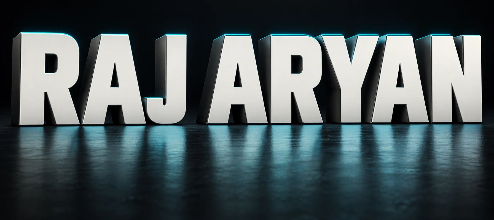
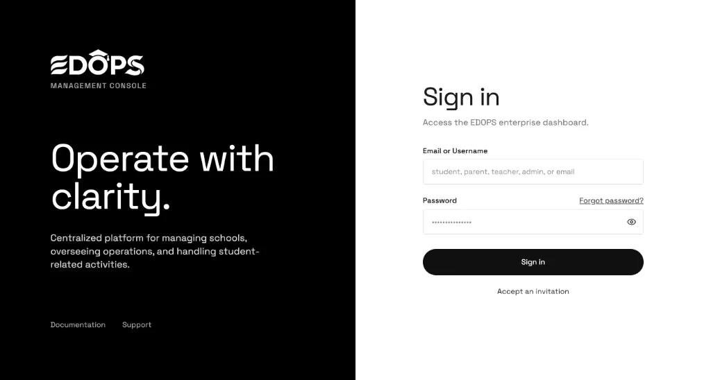
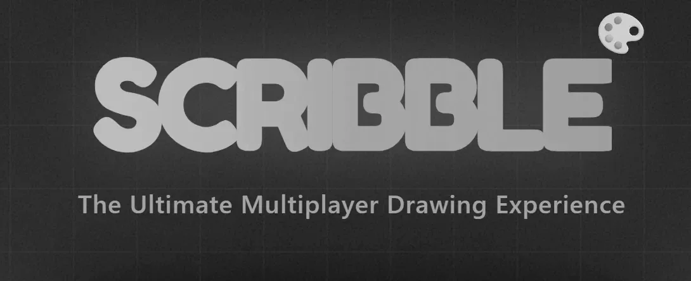
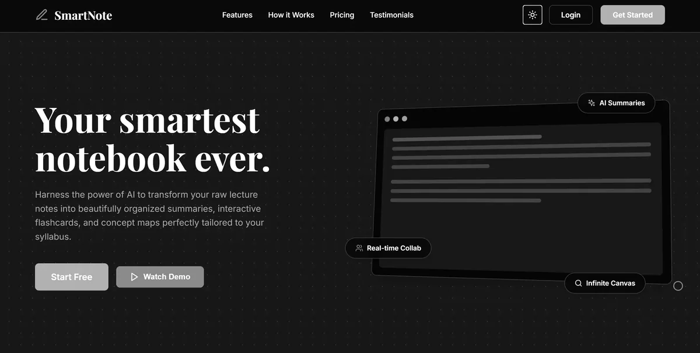
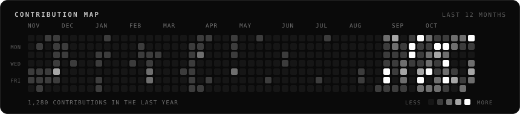
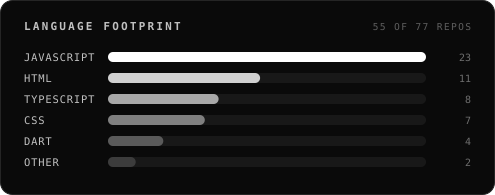

<!-- Raj Aryan · profile README
     Monochrome only: #050505 #0A0A0A #1A1A1A #252525 #808080 #C0C0C0 #FFFFFF -->

<p align="center"><a href="https://iamrajaryan.netlify.app/"></a></p>

<p align="center"></p>

<p align="center">   </p>

## 01 · Profile

<sub>// WHO / WHERE</sub>

Full-stack engineer and founder in Bengaluru. I build backends, distributed systems and AI products — currently an LMS for schools, plus my own software studio. Founding member at EDOPS, founder at Kvira, and a dual-degree student at IIT Madras and Polaris School of Technology.

```text
raj@bengaluru ~ % whoami --verbose

name        Raj Aryan
role        full-stack engineer / founder
base        Bengaluru, India
focus       distributed systems · AI products · offline-first mobile
building    EDOPS (school LMS) · Kvira (software studio)
learning    Go in production · cheaper inference
philosophy  ship the boring version first, measure, then rewrite
objective   software that survives real schools, real networks, real users
```

## 02 · Stack

<sub>// WHAT I REACH FOR</sub>

| LAYER | TOOLING |
| :--- | :--- |
| `LANGUAGES` |      |
| `FRONTEND` |    |
| `BACKEND` |       |
| `DATA` |      |
| `MODELS` |     |
| `DELIVERY` |      |

## 03 · Selected work

<sub>// SHIPPED, IN PRODUCTION</sub>

<table>
<tr>
<td width="330"></td>
<td width="510">

**EDOPS — school LMS** · *Founding member*

Schools run setup, academic structure and rosters across spreadsheets and three different tools. EDOPS puts all of it in one workspace. I ran discovery across four schools and built the academic-structure and roster flows.

`Next.js` `React` · [repository](https://github.com/EDOPS-IND)

</td>
</tr>
<tr>
<td width="330"></td>
<td width="510">

**Chromo — paint e-commerce** · *Co-founder*

The paint trade still runs on phone calls. We shipped the MVP with a full ordering flow, catalogue to checkout, live on Vercel.

`MERN` · [live](https://chromo-web.vercel.app/) · [repository](https://github.com/raj-aryan-official/Chromo-Web.git)

</td>
</tr>
<tr>
<td width="330"></td>
<td width="510">

**Scribble — multiplayer drawing game** · *Independent*

Canvas state syncs over WebSockets, turns run on a scoring engine I wrote, and voice chat happens inside the game instead of a second call.

`Next.js` `Express` `WebSockets` · [repository](https://github.com/raj-aryan-official/Scribble.git)

</td>
</tr>
<tr>
<td width="330"></td>
<td width="510">

**Notebook — AI study workspace** · *Independent*

Turns lecture notes into summaries, flashcards and concept maps. Built around the fact that students revise from raw, badly formatted notes.

`React` `NLP` · [live](https://newainotebook.netlify.app/) · [repository](https://github.com/raj-aryan-official/notebook.git)

</td>
</tr>
</table>

## 04 · Ventures

<sub>// COMPANIES</sub>

| VENTURE | ROLE | WHAT IT IS |
| :--- | :--- | :--- |
| **Kvira** | Founder | Software studio: web platforms, enterprise tools, distributed systems. |
| **Sankalp Siddhi** | Founder | Builder community: 200+ members across 50+ universities, 9 student projects. |
| **Bharat Navodaya Shiksha** | Co-founder · Tech lead | AI, coding and robotics labs for schools, aligned to NEP 2020 certification. |

## 05 · Engineering notes

<sub>// WHAT I ACTUALLY SOLVED</sub>

**Automated essay scoring.** Fine-tuned BERT with LoRA across eight prompt types. The interesting problem was throughput: a Postgres job queue using `FOR UPDATE SKIP LOCKED` lets concurrent workers claim jobs without blocking each other, and ONNX Runtime keeps inference affordable on CPU. JWT auth, four-role RBAC, 130+ pytest tests, Playwright end-to-end, Docker Compose and GitHub Actions.

**Offline-first mobile.** Voice Notes Plus does real-time speech-to-text, tag search and sharing with no network — Hive as the source of truth, not a cache. AssetWize does the same for property and portfolio tracking, behind biometrics.

## 06 · GitHub

<sub>// PUBLIC SIGNAL</sub>

<p align="center"></p>

<p align="center"></p>

<p align="center"></p>

## 07 · Numbers

<sub>// RECEIPTS</sub>

<table>
<tr>
<td width="270" align="center"><h3>06</h3><sub>VENTURES FOUNDED</sub></td>
<td width="270" align="center"><h3>38+</h3><sub>PROJECTS SHIPPED</sub></td>
<td width="270" align="center"><h3>13+</h3><sub>CLIENT SITES DELIVERED</sub></td>
</tr>
<tr>
<td width="270" align="center"><h3>608</h3><sub>LEETCODE SOLVED</sub></td>
<td width="270" align="center"><h3>1,610</h3><sub>PEAK CONTEST RATING</sub></td>
<td width="270" align="center"><h3>30.19%</h3><sub>LEETCODE PERCENTILE</sub></td>
</tr>
</table>

263 easy · 276 medium · 69 hard — Java first, C++ STL when the problem needs it.

## 08 · Education

<sub>// ONGOING</sub>

| DEGREE | INSTITUTION | YEARS |
| :--- | :--- | :--- |
| B.Tech, Computer Science & Engineering (AI & ML) | Polaris School of Technology, Bengaluru | 2024–2028 |
| B.S., Data Science & Applications | Indian Institute of Technology Madras | 2024–present |

## 09 · Contact

<sub>// ELSEWHERE</sub>

<p align="center"><a href="https://github.com/raj-aryan-official"></a> <a href="https://www.linkedin.com/in/rajaryanofficial/"></a> <a href="https://iamrajaryan.netlify.app/"></a> <a href="https://leetcode.com/u/raj_aryan_official/"></a> <a href="mailto:learn.raj.aryan@gmail.com"></a></p>

<p align="center"><sub>learn.raj.aryan@gmail.com · Bengaluru, India</sub></p>

<p align="center"></p>
